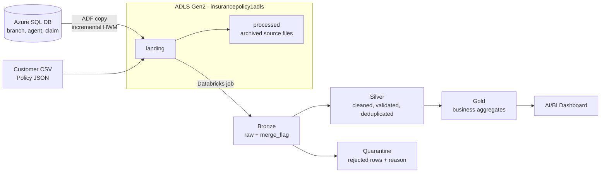

# Smart Policy System – Azure Lakehouse

An end-to-end insurance data platform on Azure. **Azure Data Factory** ingests policy, customer, claim, agent and branch data into **ADLS Gen2**. **Azure Databricks (serverless, Unity Catalog)** refines it through a **Bronze → Silver → Gold** medallion architecture, and the result feeds a **Databricks AI/BI dashboard** for business KPIs such as premium, claims and loss ratio.


| KPI (snapshot) | Value |
|---|---|
| Policies | 349 |
| Total premium | $37.47M |
| Total claims paid | $31.76M |
| **Overall loss ratio** | **84.8%**: for every $100 of premium, $84.80 is paid out in claims |

---

## Architecture



**Orchestration**
- `Daily_Once_At_Midnight` (ADF trigger): runs the copy pipelines from Azure SQL into `landing/`.
  - Agent and Claim loads are **incremental**, using a high-watermark (HWM) file.
  - Branch is a full copy.
- `Daily_Once_At_1` (ADF trigger): starts the Databricks job **PolicySystem_Medallion** through ADF's **Databricks Job activity**.
- The Databricks job has 11 tasks, all on **serverless** compute:

```
bronze_branch   -> silver_branch   -> silver_agent  <- bronze_agent
bronze_customer -> silver_customer -> silver_policy <- bronze_policy
                                      silver_policy -> silver_claim <- bronze_claim
                                                       silver_claim -> gold
```

## Tech stack
Azure Data Factory · ADLS Gen2 · Azure SQL Database · Azure Databricks (serverless, Unity Catalog, Lakeflow Jobs) · Delta Lake · PySpark · Spark SQL · Databricks AI/BI Dashboards

---

## Layers

### Bronze: raw, append-only
- One notebook per entity reads only the new files in `landing/<Entity>/`. Formats are Parquet, CSV or JSON.
- Each notebook appends the rows to a managed Delta table with `merge_flag = false`, `source_file` and `ingestion_timestamp`.
- It then moves exactly those files to `processed/<Entity>/<date>/<time>/`.
- An empty landing folder exits cleanly, so re-runs are safe.

### Silver: clean, validated, deduplicated
Silver tables are external Delta tables in the `silver` container. Each entity notebook:
1. Reads only unprocessed bronze rows (`merge_flag = false`).
2. Cleans the data: trims, normalises case, applies defaults and casts types.
3. Deduplicates with a window function and deterministic tie-breakers.
4. Classifies every row with a `reject_reason`:

| Outcome | Example | Goes to | Bronze flag |
|---|---|---|---|
| Valid | – | `silver.<entity>` via **MERGE** (upsert) | `true` |
| Hard reject | invalid gender, registration before birth, null key | `silver.quarantine_<entity>` | `true` |
| Soft reject | policy whose customer is not in silver yet | stays in bronze, retried next run | `false` |

Foreign keys are checked against **silver**, not bronze, so a child row never points to a parent that was rejected.

### Gold: business aggregates (full refresh)

| Table | Business question |
|---|---|
| `gold.sales_by_policy_type_and_month` | Premium sold per policy type per month |
| `gold.claims_by_policy_type_and_status` | Claim count and amount per policy type and claim status |
| `gold.claim_analysis_by_policy_type` | Claim count / avg / min / max, claim frequency and **loss ratio** per policy type |

- Claim statistics and premium are aggregated separately before the join. This avoids the fan-out trap, where a policy's premium would be counted once per claim.
- A reconciliation check confirms that gold adds up exactly to silver.

---

## Dashboard
Built with Databricks AI/BI, mostly on the gold tables. It has KPI tiles, premium and policies sold by month, loss ratio by policy type, claims by policy type and status, the claim amount distribution, and a global Policy Type filter. The distribution chart reads claim-level data from silver, because a box plot needs individual claims rather than aggregates. A full PDF export is in [`docs/Policy_System_Insurance_Analytics.pdf`](docs/Policy_System_Insurance_Analytics.pdf).

What the data shows:
- **Health** has the highest loss ratio (89.9%), ahead of **Auto** (80.0%) and **Unknown** (77.8%), so Health is the least profitable line.
- Claim sizes are similar for Health and Auto (median about $100K), and Health has more claims. This suggests its higher loss ratio comes mainly from claim **frequency**, not claim size.
- **Unknown** policy types are policies with a missing `policy_type`, defaulted in silver. Their share is small, but they are a data-quality item to raise with the source owner.
- April 2023 is the last month in the data, so its dip may be a partial month rather than a real drop in sales.

To recreate it in another workspace, open **Dashboards → Create → Import dashboard from file**, select `databricks/dashboards/Policy_System_Insurance_Analytics.lvdash.json`, then attach a SQL warehouse.

---

## Engineering decisions and problems solved
- **Serverless-only workspace.** Cluster deployment failed in this subscription, and ADF's Notebook activity requires a cluster. The fix was to orchestrate one multi-task Databricks Job and trigger it from ADF's **Databricks Job activity**.
- **Ingestion data-loss bug.** The original bronze load moved the whole landing folder. That caused `PATH_NOT_FOUND` errors and risked archiving files that were never read. The notebooks now list the files, read exactly those, write, and then move only those files.
- **Data quality without silent loss.** Every rejected row is kept in a quarantine table with its reason. Orphan children are retried instead of dropped.
- **Job as code.** The job definition (tasks, dependencies, serverless, `max_concurrent_runs = 1`) is written by a notebook using the Databricks SDK, so it is reproducible.

## Known limitations / next steps
- The two ADF triggers are chained **by time** (midnight, then 1 AM), not by dependency. Next step: one master pipeline that runs the copies, then the Databricks job.
- Customer and Policy files are placed in `landing/` directly. There is no ADF copy pipeline for them yet.
- The policy feed has no `agent_id`, so agent and branch performance cannot be reported yet.

---

## Repository structure
```
├── pipeline/ dataset/ linkedService/ trigger/ factory/   # Azure Data Factory (Git-integrated, do not edit by hand)
├── databricks/
│   ├── setup/        # schemas, volumes, one-time fixes
│   ├── bronze/       # *_Ingestion notebooks
│   ├── silver/       # Silver_*_Implementation notebooks
│   ├── gold/         # Gold_Layer_DataLoad
│   ├── jobs/         # Create_Medallion_Job (job as code)
│   └── dashboards/   # Policy_System_Insurance_Analytics.lvdash.json
└── docs/             # dashboard screenshot (images/) and PDF export
```
